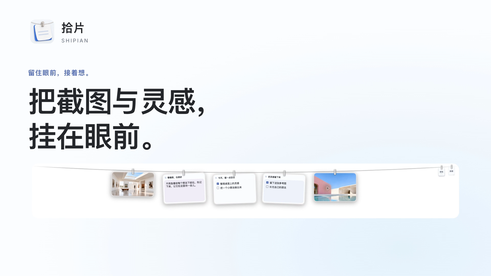
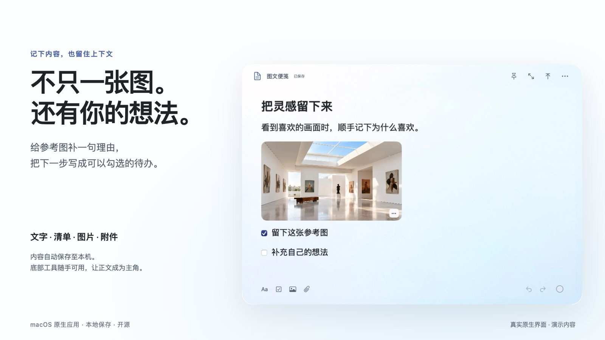
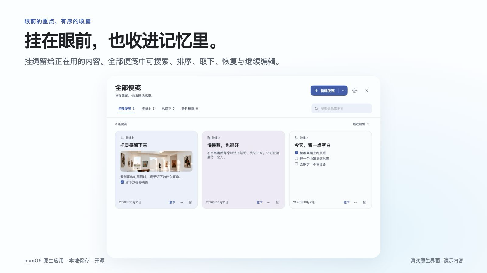
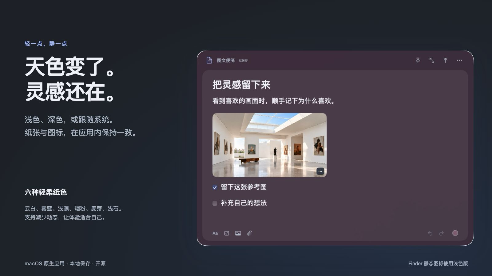

<picture>
  
</picture>

<p align="center">
  <strong>拾片 Shipian</strong> · 把截图与灵感，挂在眼前。<br>
  macOS 原生 · 本地保存 · 开源<br><br>
  <a href="../../releases">下载测试版</a> · <a href="#三步开始">三步开始</a> · <a href="#从源码构建">源码构建</a> · <a href="docs/launch/PRODUCT.md">完整产品介绍</a>
</p>

截图留下画面，便笺接住想法。拾片把两者挂在屏幕顶部的一条绳上：要用时展开，写完再收回。给喜欢的图补一句“为什么”，把临时想法写下来，或者留一张今天的待办，不必反复切换窗口。

> 当前为 **0.5.0 测试版**。提供 Apple Silicon（arm64）安装包，最低 macOS 14。采用本地 ad hoc 签名，**尚未经过 Apple 公证**；从互联网下载后，其他 Mac 可能需要在系统设置中手动确认打开。

## 先看它怎么用

[](docs/media/shipian-intro.mp4)

[观看产品介绍 MP4](docs/media/shipian-intro.mp4) · [查看分镜与字幕](docs/launch/VIDEO.md)

视频基于真实应用界面制作，使用虚构演示内容；画面运镜用于讲解产品，不作为实际动画流畅度测试。

## 截图与便笺，放在一起


- **截图挂绳**：沿用 Tendedero 的夹子、玻璃边框与摆动机制，截图和便笺处于同一个挂绳体系。
- **按需展开**：打开一张便笺继续编辑，收起后回到挂绳；便笺内容保留。
- **轻量入口**：绳尾保留便笺库和新建入口，优先把空间留给内容。

## 给一张图，添一点自己的想法



同一张便笺中可使用文字、待办清单、图片与文件附件；支持文字格式、撤销和重做。内容自动保存到本机，保存出错时会显示错误状态。底部工具融入纸张，常用操作不遮挡正文。

附件导入时会复制到应用的数据目录；Markdown 导出可携带附件，便于继续使用。

## 挂在眼前，也收进记忆里



便笺库提供「全部便笺」「挂绳上」「已取下」「最近删除」，支持标题和正文搜索、排序、制作副本与导出。从绳上取下会保留便笺；移入最近删除后可恢复，永久删除需要再次确认。

## 从白天，到夜里



支持浅色、深色和跟随系统，提供云白、雾蓝、浅藤、烟粉、麦芽、浅石六种纸色。按钮有悬停提示；下拉菜单选项直接展示名称，不叠加重复提示。支持应用及系统的减少动态偏好。

已内置浅色与深色图标，应用运行时图标和设置中的图标随外观更新。Finder 中的静态图标使用浅色版。

## 三步开始

1. 从 [Releases](../../releases) 下载 `Shipian-0.5.0-arm64.dmg`，打开后将「拾片.app」拖到应用程序，或使用 ZIP 中的应用。
2. 启动后打开便笺库，新建文字、待办或图文便笺。写好后再挂上；新建自动挂上默认关闭。
3. 在顶部挂绳中展开便笺继续编辑；暂时不用的内容取下后，仍可在便笺库找到。

拾片是菜单栏应用，关闭窗口后仍可从菜单栏打开；需要完全退出时使用「退出拾片」。截图监听、截图接管与剪贴板图片挂绳按需在菜单栏启用，使用前请读清对应设置说明。本项目不使用原版 Tendedero 的应用身份或数据目录。

### 常用快捷键

| 操作 | 快捷键 |
| --- | --- |
| 新建便笺 | `⌘N` |
| 搜索 | `⌘F` |
| 撤销 / 重做 | `⌘Z` / `⇧⌘Z` |
| 加粗 / 斜体 / 下划线 | `⌘B` / `⌘I` / `⌘U` |
| 收起当前便笺 | `Esc` |

全局挂绳快捷键在菜单栏设置，可能因个人设置而不同。

## 数据与当前边界

便笺及附件副本保存在 `~/Library/Application Support/LineNotes Test`。测试版保留这个目录名称，是为了继续读取已有测试数据。请勿同时运行旧版 LineNotes Test 和拾片。

当前应用没有账号、云同步和协作服务。请自行备份本地数据目录。仓库中的演示图片与笔记不包含用户个人截图。当前提供的二进制仅在 Apple Silicon 上验收；Intel 编译和跨设备测试尚未完成，也没有 App Store 版本。

## 从源码构建

需要 macOS 14 或更新系统、Swift 5.9 或更新工具链（Xcode / Command Line Tools）、Python 3 和 `ripgrep`（UI 验收脚本使用）。

```sh
git clone https://github.com/LeeYH95/shipian.git
cd shipian
scripts/build-shipian-test-app.sh
open 'build/shipian-test-release/拾片.app'
```

构建脚本使用本机架构，不会自动生成通用二进制。应用输出到 `build/`，使用 ad hoc 签名。

```sh
# 单元与集成测试
CLANG_MODULE_CACHE_PATH="$PWD/.build/ModuleCache" \
SWIFTPM_MODULECACHE_OVERRIDE="$PWD/.build/ModuleCache" swift test --disable-sandbox

# 原生 UI 行为验收；需要可用的 macOS 桌面会话
Tests/NativeNotesUIHarness/run.sh

# 独立演示数据，不扫描个人截图、不注册全局快捷键
'build/shipian-test-release/拾片.app/Contents/MacOS/LineNotes' \
  --demo --data-dir "$PWD/runtime/demo"
```

## 反馈与参与

使用 [Bug 报告](../../issues/new?template=bug_report.yml) 提交系统版本、应用版本、复现步骤与预期行为；截图前请遮挡个人信息。提出功能想法请说明实际场景。欢迎提交聚焦的 Pull Request；涉及数据保存、附件和删除行为的改动需要测试。

## 配套发布 Skill

仓库附带 [github-product-launch](skills/github-product-launch/README.md)，用于给其他项目制作 README、Banner、功能说明、介绍视频和发布检查报告。它会先核对真实功能与素材来源，准备完成后按用户已授权的范围发布。

## 来源与许可

拾片基于 [Tendedero](https://github.com/alejandrobujan/tendedero) v1.5.0 二次开发，保留其截图挂绳与物理交互机制。感谢 Alejandro Buján 的原始实现。

代码遵循 [MIT License](LICENSE)，上游名称和图标不在该授权内。本项目使用独立名称、图标与宣传素材，不代表得到上游背书。详见 [NOTICE.md](NOTICE.md)。
